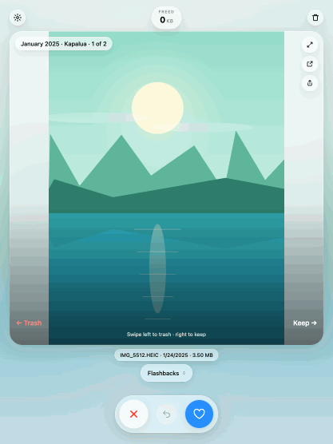
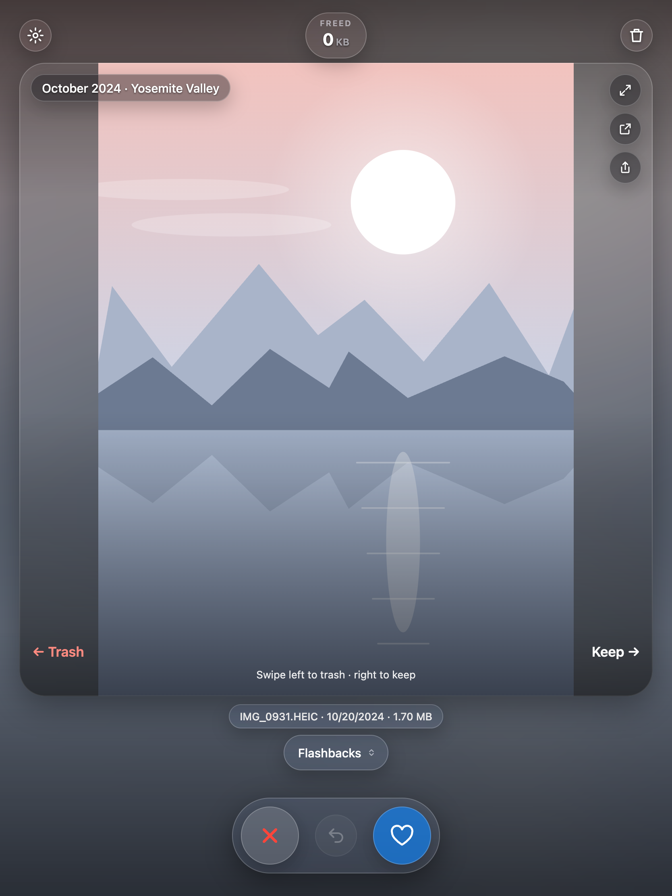

# Photos Swipe

Tinder-style cleanup for Google Photos. See one photo or video at a time, swipe left to mark it for Trash, swipe right to keep it, then review your picks and move them to Google Photos Trash in one go.

It's a userscript that runs inside your own signed-in [photos.google.com](https://photos.google.com) tab, on iPhone, iPad and desktop. No app, no server to run, no Google password to hand over.

<p align="center">
  
  &nbsp;&nbsp;
  
</p>

## Features

- **Swipe, tap or use the keyboard.** ← / ✕ marks for Trash, → / ♥ keeps, Z / ↺ undoes, even after a reload.
- **Flashbacks.** Memories from across your timeline, shuffled. Timeline, Oldest first and Largest first are there too.
- **See what you'll free.** The counter adds up the space your marked items use. Items Google stores for free are labelled so the number stays honest.
- **Review before anything is deleted.** Going to Trash shows everything you marked. Untick to keep, then **Move N to Trash**. Items stay restorable in Google Photos Trash for 60 days, and nothing is ever permanently deleted.
- **Look closer.** Pinch to zoom, go fullscreen, open the item in Google Photos, or share the photo or video itself.
- **Fast on big libraries.** Upcoming photos preload, so swipes are instant. Tested on a 34,000-item library.
- **Optional sync** between your phone and computer (Settings › Sign in with Google).

<p align="center">
  
  &nbsp;
  
</p>
<p align="center"></p>

## Get started

1. Install a userscript manager:
   - **iPhone / iPad:** [Userscripts](https://github.com/quoid/userscripts) for Safari.
   - **Desktop:** [Tampermonkey](https://www.tampermonkey.net/) or Violentmonkey. In Chrome, turn on **Allow User Scripts** in Tampermonkey's extension details.
2. Open the [install link](https://photoswiper-sync.sidlakkoju.workers.dev/photoswiper.user.js) and accept the install.
3. Open [photos.google.com](https://photos.google.com) in that browser and tap **Photos Swipe** at the bottom right.

It updates itself every time Google Photos loads. Per-browser details are in [docs/userscript.md](docs/userscript.md). Want to look first? Try the [live demo](https://sidlakkoju.github.io/photos-swipe/) with sample photos.

## Development

You need Node.js 22.13 or newer. There are no dependencies to install.

```sh
node scripts/build-userscript.mjs   # build lib/ into userscript/
npm run build:demo                  # self-contained demo with sample photos in demo-dist/
python3 -m http.server -d demo-dist 8000   # then open http://localhost:8000
npm test                            # 1,200+ tests, including Chromium and WebKit runs of the built script
```

- The source is in `lib/` (`userscript-ui.mjs` is the interface). The build writes `userscript/photoswiper-app.user.js`, the whole app as one file.
- To try your changes on your real library, install `userscript/photoswiper-app.user.js` in your userscript manager in place of the published script, then reload Google Photos.
- Browser tests need Playwright once, without touching `package.json`:

  ```sh
  npm i --no-save --no-package-lock playwright && npx playwright install chromium chromium-headless-shell webkit
  ```

More in [architecture](docs/architecture.md), [development](docs/development.md), [sync](docs/sync.md), [performance](docs/performance.md) and [demo](docs/demo.md).

## Deploying

Releases are served and signed by a small Cloudflare Worker, which also hosts the install link and the optional sync.

1. Bump `@version` in `scripts/build-userscript.mjs`.
2. Run `./scripts/deploy-worker.sh`. It builds the script, signs the release, applies database migrations and deploys the Worker.

It needs `CLOUDFLARE_API_TOKEN` and `CLOUDFLARE_ACCOUNT_ID` (from the environment or `~/.photoswiper/cloudflare.env`), plus the Ed25519 release key at `~/.photoswiper/photoswiper-signing.key` or `PHOTOSWIPER_SIGNING_KEY`. Installed scripts check for the signed release when Google Photos loads and switch to it automatically.

## How it works

```
photos.google.com tab
 └─ Photos Swipe userscript
     ├─ reads your library and moves items to Trash through the web API the Photos site itself uses
     ├─ keeps decisions and progress in the browser (IndexedDB)
     └─ optional: syncs item IDs, decisions and progress through the Cloudflare Worker
        (never photos, names, locations or preview links)
```

Swiping only records a decision. Nothing leaves your library until you confirm **Move N to Trash**, and photos are never uploaded anywhere. See [privacy](docs/privacy.md).

Google Photos has no official API for this, so the script relies on the site's undocumented one and can need fixes when Google changes it. Request formats are adapted from [Google Photos Toolkit](https://github.com/xob0t/Google-Photos-Toolkit) (MIT, see [third-party notices](extension/THIRD_PARTY_NOTICES.md)).
