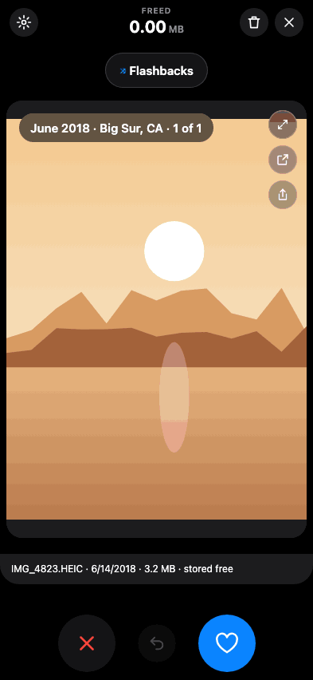
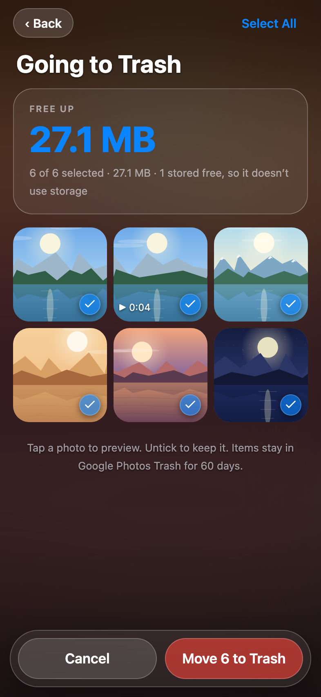
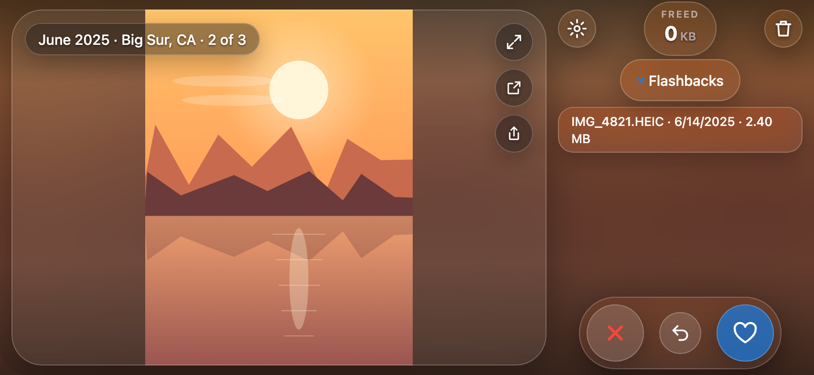
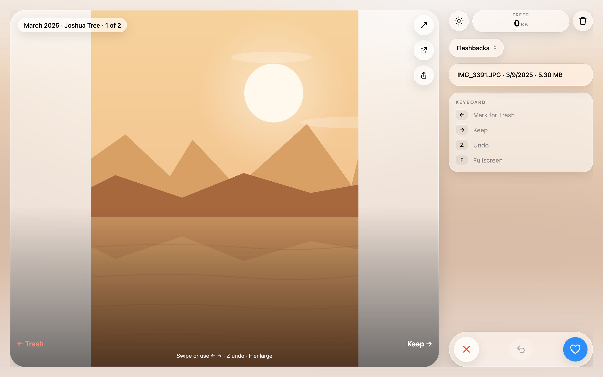

# Photos Swipe

Tinder-style cleanup for your Google Photos library. Photos Swipe shows one photo or video at a time: swipe left to send it toward the Trash, swipe right to keep it. When you're done, review what you marked and move it to Google Photos Trash in one step.

<p align="center"></p>

It's a userscript that runs inside your signed-in [photos.google.com](https://photos.google.com) tab on desktop browsers and iPhone Safari. There's no app to install and no Google password to hand over.

## What it does

- **Swipe through your library.** Swipe, tap ✕ / ♥ or use ← → on a keyboard. Undo goes back through your recent decisions, even after a reload.
- **Flashbacks.** The default order shuffles whole memories (photos taken around the same time and place) across your timeline. Timeline, Oldest first and Largest first are also available.
- **Storage freed, live.** The counter at the top rolls up as you mark items. Items Google stores for free (most photos backed up before June 2021) are labelled *stored free* and add nothing, so the number matches what Google actually counts.
- **Review before anything is deleted.** Going to Trash shows every marked item in a grid. Tap ✓ to rescue one, then move the rest to Google Photos Trash. Every batch is verified in Trash, and items stay restorable there for 60 days.
- **The photo comes first.** A blurred copy of the current photo fills the background and every control floats on glass above it, in dark or light mode. On a computer the photo takes most of the window with the controls beside it; on a phone it adapts to portrait or landscape.
- **Look closer.** Pinch to zoom into a photo or video, open the item in Google Photos to see what else is around it, or go fullscreen. Fullscreen follows your device as you rotate it.
- **Share without waiting.** Share the photo or video itself. A ring around Share shows the download; keep swiping and it waits in the share tray until you send it.
- **Fast on big libraries.** Upcoming photos are preloaded, so swipes are instant. It's tested against a 34,000-item library.
- **Sync across devices (optional).** Sign in with Google in Settings to carry decisions and progress between your phone and computer.

<p align="center">
  
  &nbsp;
  
</p>
<p align="center"></p>

## How it works

```
photos.google.com tab
 └─ Photos Swipe userscript
     ├─ reads your library and moves items to Trash through the same web API the Photos site uses
     ├─ keeps decisions and progress in the browser (IndexedDB)
     └─ optional: syncs item IDs, decisions and review progress to a small Cloudflare Worker
        (never photos, names, locations or preview links)
```

Swiping only records a decision. Nothing leaves your library until you confirm **Move N to Trash**, and there's no permanent delete. Photos and videos are never uploaded anywhere. Sync, if you turn it on, also stores your Google account ID and email for sign-in. See [privacy](docs/privacy.md).

## Install

1. Install a userscript manager:
   - **Desktop:** [Tampermonkey](https://www.tampermonkey.net/) or Violentmonkey.
   - **iPhone/iPad:** [Userscripts](https://github.com/quoid/userscripts) for Safari.
2. Open the [Photos Swipe install link](https://photoswiper-sync.sidlakkoju.workers.dev/photoswiper.user.js) and accept the install.
3. Open Google Photos in the browser and tap the **Photos Swipe** button at the bottom right.

The script updates itself. Step-by-step setup for each browser is in [docs/userscript.md](docs/userscript.md).

| Action | Touch | Keyboard |
| --- | --- | --- |
| Keep | Swipe right or ♥ | → |
| Mark for Trash | Swipe left or ✕ | ← |
| Undo | ↺ | Z |
| Fullscreen | ⤢ | F |
| Play / pause video | Tap the video | Space |

## Development

```sh
npm test                  # ~950 tests, including headless Chromium and WebKit runs of the built userscript
npm run build:demo        # static, self-contained demo with sample photos in demo-dist/
./scripts/deploy-worker.sh  # rebuild, sign and publish the userscript and sync Worker
```

The userscript source lives in `lib/` and builds to `userscript/`. Browser tests need Playwright (`npm i --no-save --no-package-lock playwright && npx playwright install chromium webkit`). The demo build and its iframe API are in [demo](docs/demo.md). More in [development](docs/development.md), [architecture](docs/architecture.md), [sync](docs/sync.md) and [performance](docs/performance.md). The original local desktop app (Node server + Chrome extension) is still in the repo; see [setup](docs/setup.md).

Google Photos access uses an undocumented web API, so it can need maintenance when Google changes its site. The request formats are adapted from [Google Photos Toolkit](https://github.com/xob0t/Google-Photos-Toolkit) (MIT; see [third-party notices](extension/THIRD_PARTY_NOTICES.md)).
