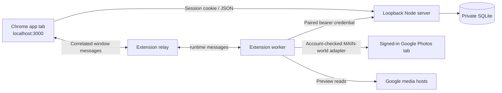

# Core architecture

The application uses vanilla browser JavaScript, a Node HTTP server, Node's built-in SQLite module and a Chrome Manifest V3 extension. There are no npm runtime dependencies or hosted services.

## Boundaries

The server validates loopback Host/Origin, authenticates UI requests with a hashed session credential and HttpOnly SameSite cookie, and authenticates extension requests with a separate hashed pairing credential. Pairing is one-time, expires, and binds the workspace to a Google account. The app does not receive Google login cookies or page authentication tokens.

The content relay accepts requests from the app's top-level localhost origin. The worker accepts its own popup/app senders, validates pairing and checks Google account identity. `photos-api.js` is serialized into the signed-in Photos page's MAIN world through Chrome scripting; Google page tokens stay there. Supported operations are narrow: identity/library/metadata/Trash reads, video lookup, album discovery/creation/membership reads and album additions. There is no Trash mutation or permanent-delete operation.

The authenticated server can buffer an allowlisted video preview URL without Google cookies. It rejects redirects/unexpected formats and caps foreground previews at 512 MB. This is separate from stored-original downloads on the experimental crop branch.

## Library and review state

`items` stores account-scoped media metadata, a keep/remove decision, a revision, album acknowledgement, active/Trash state and a sent-queue marker. Decisions update against an expected revision; stale writes fail instead of replacing another tab's decision. Reimport refreshes metadata while retaining decisions. Generated clips remain excluded, and unfinished crop originals remain protected by compatibility records.

The UI computes unreviewed items using the selected media filter/order. `import-review.js` compares reviewable IDs before/after page reads, scans past reviewed overlaps, and handles explicit exhaustion, repeated cursors and a 12-page bound. The bridge supplies an expected cursor and latest-refresh flag. `importPage()` commits metadata and pagination together; latest refresh preserves an established older cursor, while stale imports are rejected.

## Media lifecycle

Image previews are fetched by the bridge and cached in the app browser's IndexedDB. The UI decodes upcoming previews and shares requests to avoid duplicate loads. Small video previews, at most 32 MB each, warm ahead one at a time; the current-plus-two video buffers are evicted as review advances. Foreground playback shares those requests.

Compact videos autoplay muted, loop and pause when their view is left. Ordinary refreshes preserve a paused current player. The enlarged viewer manages photo zoom/pan, video controls, review decisions and Undo; queue inspection uses it without review actions. Object URLs are released as media leave the workspace or the user signs out.

## Album operations

`jobs` holds the exact candidate IDs, library keys, stable content identifiers, target album and confirmed membership. Queued/running jobs lock their decisions. The worker checks existing membership, adds missing media in chunks, and checks membership even when a write response fails. Stable identifiers handle Google's different album/library media IDs.

Only full verification marks the batch completed and sets `queue_sent`; a partial acknowledgement alone does not clear the batch. Sent markers persist independently of album availability, so reimport or disappearance of an old album does not refill a completed queue. The UI displays at most one actionable operation and a single transient toast.

## Reconciliation and estimates

A deletion check reads Google Trash, album membership and explicit item state. Confirmed Trash leaves active review while retaining history. Unknown results preserve state, and revision checks protect concurrent changes. Absence alone is not proof of permanent deletion.

The queue estimate sums the same items shown in the current removal queue. The separate Trash estimate uses confirmed historical removal candidates. Known Google quota bytes take precedence over file size; known free media contribute zero and missing sizes remain unknown.

## Persistence

Private runtime files live in `.data/`. SQLite owns imported metadata, decisions, session/pair hashes, album checkpoints, settings and reconciliation reports. Compatibility tables preserve crop jobs and generated-copy exclusions without running crop logic in core. Chrome extension storage retains its pairing credential; browser IndexedDB retains image previews. Tab-local session storage retains the last 100 swipes for Undo across reloads and imports. Entries are checked against current item decisions, revisions and eligibility before reuse; signing out or successfully sending an album clears this history. These stores are local and excluded from Git where applicable.

See [privacy.md](privacy.md) for backup boundaries, [development.md](development.md) for tests, and [core-review-status.md](core-review-status.md) for verification history.
